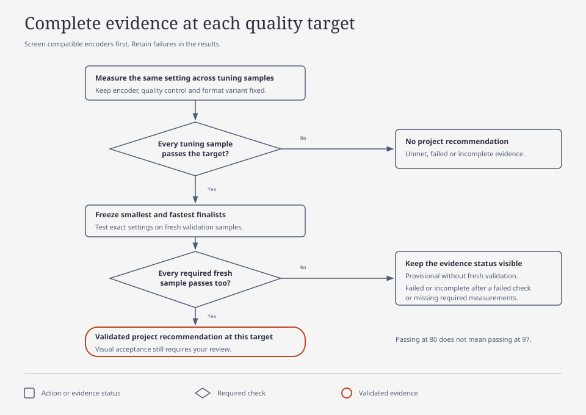

# ArchiveBench

ArchiveBench benchmarks your footage to help you choose archive presets, then uses those presets to create smaller, verified copies of future projects. Originals stay intact.

The current development focus is the terminal UI, `archivebench-tui`. Select folders or clips, choose a preset and destination, review preflight, then encode or resume a saved job. Windows **Send to > Archive footage** opens the same UI. These changes are in the working checkout; the historical v0.1.0 download does not include the current workflow. See the [current development summary](docs/release-notes.md).

<p align="center">
  <a href="pyproject.toml"></a>
  <a href="docs/benchmark.md"></a>
  <a href="pyproject.toml"></a>
  <a href="LICENSE"></a>
</p>

[Install](docs/installation.md) · [Terminal UI](docs/terminal-ui.md) · [Windows Send to](docs/windows-send-to.md) · [Choose presets](#start) · [Archive jobs](#archive-future-projects) · [Current changes](docs/release-notes.md) · [Published releases](docs/releases.md)

## Open the terminal UI


The development TUI on 2026-10-16, captured with synthetic clips and illustrative presets. These presets are not recommendations. See [Clips, Settings and Review examples](docs/terminal-ui.md#screenshots) for the full walkthrough.

From a checkout containing the current changes:

```powershell
uv sync --locked --python 3.11
uv run archivebench-tui --preset-directory "D:\Archive Presets" "D:\Project"
```

Follow **Clips > Settings > Review > Progress**. Add sources, select clips, choose a saved preset and output folder, then run preflight before Start. You can stop safely and resume the exact saved job later. If you have no presets yet, [compare representative footage](#start) first. See the [TUI guide](docs/terminal-ui.md) for audio, container, timecode and resume options.

## How it works

| Use | What you do | What you get |
| --- | --- | --- |
| **1. Find your presets** | Benchmark representative footage on your computer; compare quality, size and speed; visually inspect candidates. | An offline HTML report with charts, measurements and comparison clips, plus your chosen preset JSON files. |
| **2. Archive new projects** | Choose a saved preset and a different footage folder. | Smaller verified copies, actual savings and a job checkpoint you can resume. No new benchmark is required. |

For example, approve a higher-quality match-source preset and a smaller 10-bit 4:2:0 preset. Save both in a permanent preset folder, then choose whichever fits each future project. Presets store exact encoder controls, format/audio policy and historical evidence; each project's job stores its own folders and a snapshot of the chosen settings. You can keep using these presets without an agent or API key.


[Open the user-flow diagram](docs/diagrams/user-flow.html). Cleanup is a separate decision after visual review and verification.

## Start

**Start with a quick comparison.** Select your camera footage, CPU/GPU encoders (or `all`), explicit output formats and a total time allowance, default 30 minutes. Setup saves five-second sections and two fixed compression settings per encoder. The runner measures their actual quality, storage and speed without chasing a VMAF target. It compares one setting per encoder before the second setting, then checks the first scene's measured frontier on additional selected scenes while time remains.

The allowance includes hashing, reference preparation, encoding, scoring and review/report preparation. Estimates update after measurements; unknown or unfinished work stays visible. Process cleanup and final report writes can slightly overrun the deadline. Run the benchmark alone for meaningful speed comparisons. Encoder automatic threading uses available hardware; a bounded scoring calibration checks whether a lower thread count improves throughput. The report records timing scope and preparation/scoring costs separately from encoding.

The report exports **measured starting presets**, which you can visually review and use with the archive workflow below on future folders. A short comparison does not certify unseen footage. For advanced exact-quality searches, explicitly use `archivebench setup --strategy tune`; existing saved configurations retain their original tuning behavior. See [quick comparison and refinement](docs/quick-comparison.md).

Follow the [terminal workflow](docs/terminal-workflow.md), or [install the agent skill](docs/installation.md#install-the-optional-agent-skill). Both use the same commands and evidence.

This first stage finds settings you like. If you already have a preset, go directly to [archiving a future project](#archive-future-projects).

Windows is the tested platform. macOS/Linux and their hardware encoders remain experimental.

Install [uv](https://docs.astral.sh/uv/) and a full FFmpeg build with `libvmaf`. Put `ffmpeg` and `ffprobe` on PATH. uv can provide Python 3.11. Clone the project for use with an agent or to modify it:

```powershell
git clone https://github.com/Today20092/ArchiveBench.git
cd ArchiveBench
uv sync --locked --python 3.11
uv run archivebench doctor
uv run archivebench setup --config local-config.json
uv run archivebench plan local-config.json
uv run archivebench benchmark local-config.json --output runs/first-test
```

Default setup asks for footage sections, encoders, format variants, encode repeats and a time budget. Advanced target tuning also asks for quality levels and fresh validation sections. See [configuration](docs/configuration.md) for the saved fields.

Open `runs/first-test/report.html`. No server, internet connection or Node installation is needed to view it. Follow [the report steps below](#read-the-report) to compare measurements and review the clips.

Want to see a report first? Download the [v0.1.0 synthetic demo](https://github.com/Today20092/ArchiveBench/releases/download/v0.1.0/archivebench-synthetic-demo.zip), extract the whole ZIP and open `report.html`. It shows the released interface, which may differ from this checkout. Its synthetic measurements cannot select settings for your footage and hardware.

Prefer an installed command? See the [standalone installation](docs/installation.md#install-the-command). Python distributions are available from [GitHub Releases](https://github.com/Today20092/ArchiveBench/releases).

Select motion, fine detail and dark/noisy examples. A representative sample is more informative than a large number of similar clips. `setup` lists eligible clips from a folder and asks which to include; it does not infer scene diversity. Proxy and generated archive folders are excluded.

## What is measured

ArchiveBench compares configured H.264, H.265, AV1 and VP9 encoders, including hardware encoders that pass an actual encode test. The default fixed comparison measures saved settings within your budget. The target-tuning workflow below searches compression settings and reports failures and unmet targets.

Compare named format variants in one run, including **Match source** for mixed footage. A project candidate uses the same encoder and quality across scenes. It qualifies only when every required sample passes, then the smallest and fastest finalists are checked on fresh sections that were excluded from tuning. Failed and incomplete evidence stays visible.

Compare quality levels in the same experiment. Setup offers VMAF 80, 90, 95 and 97, or a custom list. The runner reuses identical measurements across levels. Each level still needs its own complete passing evidence. A higher target can require more storage or encoding time, and some targets may remain unmet within your budget.

Choose how many encode repeats to measure per setting. The default is one. More repeats measure timing variability; they do not improve picture quality. Tuning tries different compression settings, so one repeat can still involve many encodes.



[Open the recommendation diagram](docs/diagrams/recommendation-flow.html). A budget-limited search does not prove that the best possible settings were found.

VMAF is a model score, not a percentage of original quality. Measurements cover video only. Projections exclude audio, and scores do not capture all chroma loss or prove editing quality. Read the [method and limits](docs/benchmark.md) before choosing settings.

## Read the report

1. Start with the whole collection. Use the size/time and quality/size charts to find measured settings that fit your priorities. The shaded areas show the preferred direction; they do not certify a result.
2. Check coverage. Fixed comparisons show measured starting points, including incomplete work. For target-tuning runs, compare the smallest validated collection choice at each saved target, its weakest tuning and validation scores, and projected video size and encoding time. Missing or unmet targets stay explicit.
3. Select a setting from a chart or choice card. Use the two setting selectors to compare size, time and VMAF differences for the same sample coverage. Open the sortable measurements table for details.
4. Inspect the evidence and footage. Quick comparisons defer browser assets by default; use [review preparation](docs/quick-comparison.md) for a selected trial or open its exact files in the native viewer. When assets are available, inspect matched native-size stills and paired playback. Browser review previews use H.264 8-bit 4:2:0 and cannot prove source-format fidelity.
5. Use **Export reusable preset** to save each choice as a JSON file in your permanent preset folder. Give it a recognizable filename, such as `lumix-higher-quality.json` or `lumix-smaller.json`. The preset carries exact settings, measured evidence, scope and saved visual-review references. Legacy archive-settings exports and decision summaries remain available. Review marks do not authorize cleanup.

The report starts with the selected sources' combined duration. Changing duration scales that source mix to estimate video size and encoding time. Target and duration controls use saved measurements; they do not run new tests or change the saved experiment conclusion. Older results without full source durations show a labeled sample-duration estimate.

Read [the benchmark guide](docs/benchmark.md) for scoring, validation, playback limits and restart behavior. Keep `review/` beside `report.html` for native stills and companion playback.

## Configuration and restart

- Keep source bit depth/chroma, or choose 8/10-bit 4:2:0 or 4:2:2.
- Keep resolution, or cap it at 2160p, 1440p, 1080p or 720p. Smaller sources are not enlarged; frame rate stays unchanged.
- Save archive retention choices alongside the benchmark. New configs copy all audio and retain supported subtitles, attachments, metadata and chapters by default.

See the [configuration reference](docs/configuration.md) for every option. HDR, interlaced and variable-frame-rate footage are unsupported.

For a benchmark, rerun the same command to reuse completed measurements. Changed experiment settings, sources or toolchains require a new output folder. See [restart and budget behavior](docs/benchmark.md#restart-and-budgets). Everyday archive jobs have their own [file-level resume](#resume-an-archive-job).

## Archive future projects

Once you have approved presets, ArchiveBench is your archival tool. Tomorrow's project might contain five original clips. Apply today's saved smaller preset without running another benchmark:

```powershell
archivebench job create "D:\New Project\archive-job.json" `
  --source "D:\New Project\Originals" `
  --output "D:\New Project\Archived" `
  --preset "D:\Archive Presets\lumix-smaller.json"

archivebench job inspect "D:\New Project\archive-job.json"
archivebench job run "D:\New Project\archive-job.json" --execute
```

Choose your higher-quality preset instead when that is what you want. For another project, create another job pointing to its source/output folders and reuse either preset. The saved presets remain portable; jobs have independent checkpoints. Editing a preset later does not change an existing job's snapshot.

Inspection shows compatibility, scope, available time/size estimates and exceptions; it runs short scratch probes. Execution encodes the selected files, verifies outputs and records actual savings including retained streams. Outputs are MKV; originals stay intact. Unsupported preservation cases keep originals, and files without worthwhile savings are retained. Consider a short confirmation comparison when footage or hardware differs materially from your tested scope, rather than repeating a full benchmark for every project.

### Resume an archive job

After interruption, run the **same job command again**:

```powershell
archivebench job run "D:\New Project\archive-job.json" --execute
```

Verified completed files are checked and skipped. Pending files are encoded; an interrupted file restarts from its beginning. This is file-level resume, not continuation halfway through a video bitstream. Changed sources, outputs or job settings are refused rather than silently mixing results. See the [archive guide](docs/archiving.md) for exceptions, checkpoints and stale-lock handling after an abrupt shutdown.

### Windows Send to

Install the current ArchiveBench command on PATH, save your approved presets in a folder, then optionally install the per-user launcher:

```powershell
archivebench-send-to --install --preset-directory "D:\Archive Presets"
```

Select folders, clips or a mixture, then choose **Send to > Archive footage**. Windows 11 may require **Show more options**. Both archive shortcuts now open the TUI; the shortcut named **Archive footage (terminal)** is retained for compatibility. Source selections must share one drive. Choose the destination in Settings, run preflight in Review, then use Start. These shortcuts do not start a benchmark. **Review originals for deletion** opens the separate acceptance-gated cleanup workflow for one archive folder.

The TUI proposes `Archived Footage` beneath the selected project or common source folder, or beside a directly selected `Original Footage` folder. Review the destination, especially when combining projects. Resume with `archivebench-tui --job "D:\Project\Archived Footage.job.json"`. Saved jobs retain their exact settings and selected files; use a different destination for a different preset version. See [installation and removal](docs/windows-send-to.md).

Review replacements and reopen your editing-project copy before reclaiming space. Editor relinking and proprietary metadata need a separate compatibility check.

**Cleanup permanently deletes originals.** It is a separate command after visual review, with hash, decode, stream and savings checks. Benchmarking does not authorize cleanup.

## Use with Codex or Claude

Install the [portable skill](docs/installation.md#install-the-optional-agent-skill) into your client's discovery directory. It guides bounded comparisons, preset reuse, visual decisions and jobs using the same CLI as [terminal users](docs/terminal-workflow.md). A capable agent without the skill can also invoke those tools: the skill supplies procedure, while measurements and verification live in the shared engine. The [agent prompt](docs/AGENT-PROMPT.md) remains a checkout alternative. [AGENTS.md](AGENTS.md) supplies maintenance rules.

## Why I made it

I wanted to archive my own footage and free up storage. ArchiveBench gives videographers and editors a starting point to measure the tradeoffs on their own computer, choose settings, and use or adapt an archive script for finished projects.

This project was built with AI coding agents. You can ask your agent to install it, explain your results, or modify it for your workflow. Keep the saved experiment and verification checks intact when adapting it.

## Sharing results

Share the HTML report after checking its labels and preview images for private content. Include its `review/` folder for companion playback and native stills; without it, those controls show missing assets. Raw `results.json` contains local paths. Source paths are redacted in the HTML; labels and images are not.

## Development

See [development and checks](docs/development.md) for report builds, tests and synthetic examples. No personal footage is included. ArchiveBench does not redistribute FFmpeg; see the [third-party notices](THIRD_PARTY_NOTICES.md).

Report reproducible bugs through [GitHub Issues](https://github.com/Today20092/ArchiveBench/issues). Review diagnostic data before posting; raw results and configs can contain private paths.
