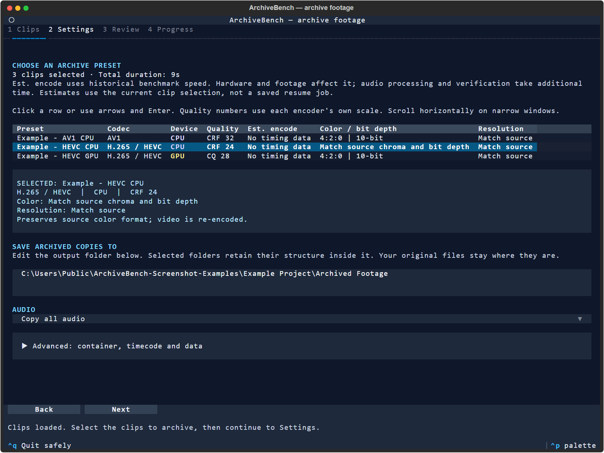

# ArchiveBench

ArchiveBench tests short sections of your footage on your computer. Compare picture quality, file size and encoding time, save an archive preset, then reuse it to make smaller, verified copies of future projects. Originals stay intact.

The workflow below describes the current development checkout. The historical v0.1.0 download does not include the current workflow. See [current changes](docs/release-notes.md) and [published releases](docs/releases.md).

<p align="center">
  <a href="docs/release-notes.md"></a>
  <a href="docs/benchmark.md"></a>
  <a href="pyproject.toml"></a>
  <a href="LICENSE"></a>
</p>

[Install](docs/installation.md) · [Find your first preset](#start) · [Use a saved preset](#archive-future-projects) · [Terminal UI](docs/terminal-ui.md) · [Current changes](docs/release-notes.md) · [Support](https://github.com/Today20092/ArchiveBench/issues)

## How it works

There are two stages. First, run a benchmark to find settings you accept. Then use your saved presets to archive projects. You do not need another benchmark for every similar project.

Your hardware determines which encoders work and how fast they run. Your footage determines the measured quality and file size. Your visual review determines which changes you accept. ArchiveBench does not select a preset from your GPU name alone.

A codec is a video format, such as HEVC or AV1. An encoder produces that format. CPU HEVC and NVIDIA GPU HEVC are separate encoders and can produce different results.

| Use | What you do | What you get |
| --- | --- | --- |
| **1. Find your presets** | Benchmark representative footage on your computer; compare quality, size and speed; visually inspect candidates. | An offline HTML report with charts, measurements and comparison clips, plus your chosen preset JSON files. |
| **2. Archive new projects** | Choose a saved preset and a different footage folder. | Smaller verified copies, actual savings and a job checkpoint you can resume. No new benchmark is required. |

For example, save one higher-quality preset and one smaller preset. Keep both in a permanent folder and choose one for each project. An archive preset stores exact settings and the historical measurement scope. Each archive job stores the project's folders and a snapshot of the selected settings. You can reuse presets without an agent or API key.



[Open the user-flow diagram](docs/diagrams/user-flow.html). Cleanup is a separate decision after visual review and verification.

## Start

Start with a **fixed comparison**. It tests two saved compression settings per encoder on five-second footage sections, with one encode per setting. It measures quality without searching for a quality target.

Choose how much time to allow, with 30 minutes offered by default. Five seconds is the footage length, not the benchmark runtime. The time allowance includes preparation, encoding, scoring and report work. The report shows unfinished work when time runs out. Final file writes and process cleanup can cause a small overrun.

The report exports measured starting presets for you to review and reuse. A short comparison does not establish quality for untested footage. See [quick comparison](docs/quick-comparison.md) for queue order, timing and review preparation.

Follow the [terminal workflow](docs/terminal-workflow.md), or [install the agent skill](docs/installation.md#install-the-optional-agent-skill). Both use the same commands and evidence.

This first stage finds settings you like. If you already have a preset, go directly to [archiving a future project](#archive-future-projects).

Windows is the tested platform. macOS/Linux and their hardware encoders remain experimental.

### 1. Check your computer

Install [uv](https://docs.astral.sh/uv/) and a full FFmpeg build with `libvmaf`. Put `ffmpeg` and `ffprobe` on PATH. uv can provide Python 3.11. Then run:

```powershell
git clone https://github.com/Today20092/ArchiveBench.git
cd ArchiveBench
uv sync --locked --python 3.11
uv run archivebench doctor
```

`doctor` checks tools and lists encoders. A listed encoder still needs to pass an actual encode on the selected footage format.

### 2. Choose short footage sections

Choose examples of the footage you usually archive. Include motion, fine detail and dark or noisy scenes. Setup lists eligible clips and asks which to include. It does not select varied scenes for you. Proxy and generated archive folders are excluded.

### 3. Set the comparison

```powershell
uv run archivebench setup --config local-config.json
uv run archivebench plan local-config.json
```

Setup saves your choices. Plan shows what will run before encoding starts.

| Choice | What it means |
| --- | --- |
| Encoders | Select CPU/GPU encoders, or enter `all` for installed encoders with supported adapters. |
| Footage sections | Short sections to measure. Results apply to the tested footage. |
| Output format | **Match source** preserves resolution, chroma, bit depth and frame rate while re-encoding. Choose reductions explicitly. |
| Time allowance | The total time available for preparation, measurements and report work. |

### 4. Run the benchmark

```powershell
uv run archivebench benchmark local-config.json --output runs/first-test
```

The runner prepares reference material, then tests one setting per encoder on the first scene before testing the second settings. The first encode also checks compatibility. Failures stay visible. The runner does not silently change your requested format.

Each successful test measures video quality, file size and encoding time. While time remains, the runner checks promising settings on additional selected scenes. Encodes run one at a time. Avoid other exports or heavy editing work during the benchmark so the speed measurements are useful.

### 5. Review and save an archive preset

Open `runs/first-test/report.html`. No server, internet connection or Node installation is needed to view it. Follow [Read the report](#read-the-report) to compare measurements, inspect the picture and export a reusable preset JSON file.

### 6. Archive future projects

Apply your saved preset through the [terminal UI](#open-the-terminal-ui) or an [archive job](#archive-future-projects). If footage or hardware differs from the preset's tested scope, check a short confirmation sample first. Keep originals until separate review and cleanup.

Want to see a report first? Download the [v0.1.0 synthetic demo](https://github.com/Today20092/ArchiveBench/releases/download/v0.1.0/archivebench-synthetic-demo.zip), extract the whole ZIP and open `report.html`. It shows the released interface, which may differ from this checkout. Its synthetic measurements cannot select settings for your footage and hardware.

Prefer an installed command? See the [standalone installation](docs/installation.md#install-the-command). Python distributions are available from [GitHub Releases](https://github.com/Today20092/ArchiveBench/releases).

## What is measured

ArchiveBench compares configured H.264, H.265, AV1 and VP9 encoders, including hardware encoders that pass an actual encode test. The default fixed comparison measures saved settings within your budget. The target-tuning workflow below searches compression settings and reports failures and unmet targets.

The default fixed comparison gives measured starting points. It does not include fresh validation. More encode repeats measure timing variability. They do not improve picture quality.

VMAF is a model score, not a percentage of original quality. Measurements cover video only. Projections exclude audio, and scores do not capture all chroma loss or prove editing quality. Read the [method and limits](docs/benchmark.md) before choosing settings.

### Optional target tuning

Use `archivebench setup --strategy tune --config refined.json` to search for settings that meet specific VMAF targets. This takes more work than a fixed comparison. A project recommendation requires complete passing measurements on tuning samples and separate fresh validation samples. Visual acceptance remains your decision.

See [target tuning and validation](docs/benchmark.md#screening-and-tuning) for the detailed recommendation diagram. A limited search does not prove that the best possible settings were found. Older saved configurations retain their original tuning behavior.

## Read the report

1. Compare quality, video size and encoding time. Use the charts to find settings that fit your priorities. The shaded areas show the preferred direction, not an accepted result.
2. Check which footage sections were measured. Failed tests and missing measurements limit the conclusion. Fixed comparisons give starting points. Target-tuning runs separately show whether each quality target passed fresh validation.
3. Select settings to compare. Use the two selectors to compare the same footage sections. Open the measurements table for details.
4. Inspect the picture. Quick comparisons defer browser stills and previews by default. [Prepare review assets](docs/quick-comparison.md) for a selected result, or open its exact files in the native viewer. Browser previews use H.264 8-bit 4:2:0 and cannot prove source-format fidelity.
5. Use **Export reusable preset** to save accepted settings as JSON in your permanent preset folder. Use a clear filename, such as `camera-higher-quality.json` or `camera-smaller.json`. The preset stores settings, measurements, tested scope and saved review references. Review marks do not authorize cleanup.

The report starts with the selected sources' combined duration. Changing duration scales that source mix to estimate video size and encoding time. Target and duration controls use saved measurements; they do not run new tests or change the saved experiment conclusion. Older results without full source durations show a labeled sample-duration estimate.

Read [the benchmark guide](docs/benchmark.md) for scoring, validation, playback limits and restart behavior. Keep `review/` beside `report.html` for native stills and companion playback.

## Configuration and restart

- Keep source bit depth/chroma, or choose 8/10-bit 4:2:0 or 4:2:2.
- Keep resolution, or cap it at 2160p, 1440p, 1080p or 720p. Smaller sources are not enlarged; frame rate stays unchanged.
- Save archive retention choices alongside the benchmark. New configs copy all audio and retain supported subtitles, attachments, metadata and chapters by default.

See the [configuration reference](docs/configuration.md) for every option. HDR, interlaced and variable-frame-rate footage are unsupported.

For a benchmark, rerun the same command to reuse completed measurements. Changed experiment settings, sources or toolchains require a new output folder. See [restart and budget behavior](docs/benchmark.md#restart-and-budgets). Everyday archive jobs have their own [file-level resume](#resume-an-archive-job).

## Archive future projects

### Open the terminal UI

Once you have a saved preset, open the terminal UI from the current development checkout:

```powershell
uv run archivebench-tui --preset-directory "D:\Archive Presets" "D:\Project"
```

Follow **Clips > Settings > Review > Progress**. Add sources, select clips, choose a saved preset and output folder, then run preflight before Start. You can stop safely and resume the saved job later.



The development TUI on 2026-10-16, captured with synthetic clips and illustrative presets. These presets are not recommendations. See the [TUI guide and screenshots](docs/terminal-ui.md#screenshots) for the full walkthrough, audio, container, timecode and resume options.

### Create an archive job

Once you have approved presets, ArchiveBench is your archival tool. Tomorrow's project might contain five original clips. Apply today's saved smaller preset without running another benchmark:

```powershell
archivebench job create "D:\New Project\archive-job.json" `
  --source "D:\New Project\Originals" `
  --output "D:\New Project\Archived" `
  --preset "D:\Archive Presets\lumix-smaller.json"

archivebench job inspect "D:\New Project\archive-job.json"
archivebench job run "D:\New Project\archive-job.json" --execute
```

Choose your higher-quality preset instead when that is what you want. For another project, create another job pointing to its source/output folders and reuse either preset. The saved presets remain portable; jobs have independent checkpoints. Editing a preset later does not change an existing job's snapshot.

Inspection shows compatibility, scope, available time/size estimates and exceptions; it runs short scratch probes. Execution encodes the selected files, verifies outputs and records actual savings including retained streams. Outputs are MKV; originals stay intact. Unsupported preservation cases keep originals, and files without worthwhile savings are retained. Consider a short confirmation comparison when footage or hardware differs materially from your tested scope, rather than repeating a full benchmark for every project.

### Resume an archive job

After interruption, run the **same job command again**:

```powershell
archivebench job run "D:\New Project\archive-job.json" --execute
```

Verified completed files are checked and skipped. Pending files are encoded; an interrupted file restarts from its beginning. This is file-level resume, not continuation halfway through a video bitstream. Changed sources, outputs or job settings are refused rather than silently mixing results. See the [archive guide](docs/archiving.md) for exceptions, checkpoints and stale-lock handling after an abrupt shutdown.

### Windows Send to

Install the current ArchiveBench command on PATH, save your approved presets in a folder, then optionally install the per-user launcher:

```powershell
archivebench-send-to --install --preset-directory "D:\Archive Presets"
```

Select folders, clips or a mixture, then choose **Send to > Archive footage**. Windows 11 may require **Show more options**. Both archive shortcuts now open the TUI; the shortcut named **Archive footage (terminal)** is retained for compatibility. Source selections must share one drive. Choose the destination in Settings, run preflight in Review, then use Start. These shortcuts do not start a benchmark. **Review originals for deletion** opens the separate acceptance-gated cleanup workflow for one archive folder.

The TUI proposes `Archived Footage` beneath the selected project or common source folder, or beside a directly selected `Original Footage` folder. Review the destination, especially when combining projects. Resume with `archivebench-tui --job "D:\Project\Archived Footage.job.json"`. Saved jobs retain their exact settings and selected files; use a different destination for a different preset version. See [installation and removal](docs/windows-send-to.md).

Review replacements and reopen your editing-project copy before reclaiming space. Editor relinking and proprietary metadata need a separate compatibility check.

**Cleanup permanently deletes originals.** It is a separate command after visual review, with hash, decode, stream and savings checks. Benchmarking does not authorize cleanup.

## Use with Codex or Claude

Install the [portable skill](docs/installation.md#install-the-optional-agent-skill) into your client's discovery directory. It guides bounded comparisons, preset reuse, visual decisions and jobs using the same CLI as [terminal users](docs/terminal-workflow.md). A capable agent without the skill can also invoke those tools: the skill supplies procedure, while measurements and verification live in the shared engine. The [agent prompt](docs/AGENT-PROMPT.md) remains a checkout alternative. [AGENTS.md](AGENTS.md) supplies maintenance rules.

## Why I made it

I wanted to archive my own footage and free up storage. ArchiveBench gives videographers and editors a starting point to measure the tradeoffs on their own computer, choose settings, and use or adapt an archive script for finished projects.

This project was built with AI coding agents. You can ask your agent to install it, explain your results, or modify it for your workflow. Keep the saved experiment and verification checks intact when adapting it.

## Sharing results

Share the HTML report after checking its labels and preview images for private content. Include its `review/` folder for companion playback and native stills; without it, those controls show missing assets. Raw `results.json` contains local paths. Source paths are redacted in the HTML; labels and images are not.

## Development

See [development and checks](docs/development.md) for report builds, tests and synthetic examples. No personal footage is included. ArchiveBench does not redistribute FFmpeg; see the [third-party notices](THIRD_PARTY_NOTICES.md).

Report reproducible bugs through [GitHub Issues](https://github.com/Today20092/ArchiveBench/issues). Review diagnostic data before posting; raw results and configs can contain private paths.
