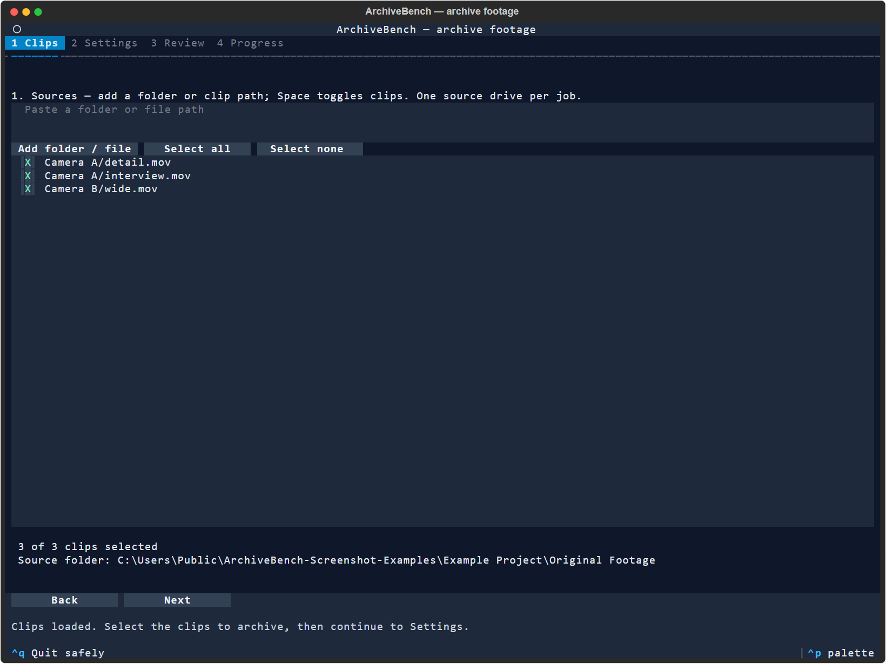
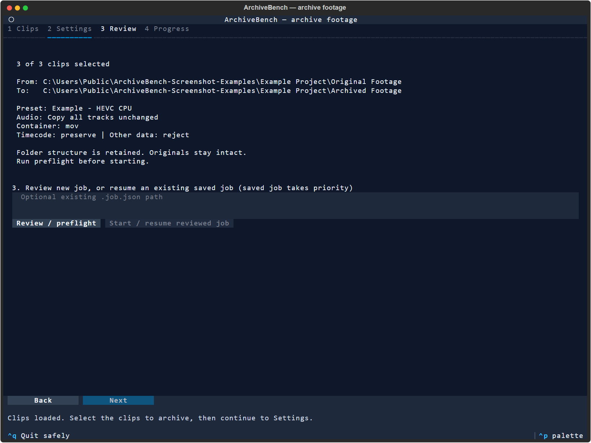

# Archive with the terminal UI

The interactive archive workflow is `archivebench-tui`, a Textual application using the same preset and job engine as the CLI. It is included in v0.2.0. See [installation](installation.md) and [release notes](release-notes.md).

Run `uv run archivebench-tui` from the checkout, or `archivebench-tui` after installing the current package. Windows [Send to](windows-send-to.md) passes selected folders and clips into this same interface. Choose the archive destination inside the UI. Choose a built-in unmeasured starter immediately, or use [quick comparison](quick-comparison.md) to create measured starting presets.

## Settings and navigation

See [the screenshots below](#screenshots) for an example selection and preset review.

The preset table compares codec, device, quality control, color format and resolution. Click a row or press Enter to select it; the summary confirms the applied preset. Arrow keys move the cursor, and narrow windows can scroll the table horizontally. The UI uses Tailwind Slate neutrals with Sky focus/selection and Amber/Rose warnings/errors.

**Est. encode** multiplies the total duration of the currently selected clips by each preset's measured encoding seconds per source second. The selected duration appears above the table. Durations are read in the background without encoding, and selecting/deselecting clips reuses those readings. Adding sources refreshes them. Missing duration metadata shows **Duration unavailable**; presets without valid measured timing show **No timing data**. These estimates describe video encoding on the historical benchmark hardware and footage, exclude audio processing and verification, and are not completion guarantees. A saved resume job has its own selection and progress; these table estimates do not describe its remaining work.

On Windows, the Send to installer defaults to the standard console host, even when WezTerm is installed. WezTerm is an optional personal preference: select it explicitly with `archivebench-send-to --install --terminal wezterm`. Both run the TUI executable directly: CMD and PowerShell are shells, not requirements for the archival UI. PowerShell remains the installer language. WezTerm uses your normal configuration, including its font and window size; ArchiveBench neither supplies a separate profile nor modifies your global configuration. Use `--terminal conhost` to return to the default.

Regular terminal commands keep your existing window size. Advanced options explain container, timecode and other data policies separately.

The interface has **Setup / compare → Clips → Settings → Review → Progress**, followed by **Accept / cleanup** after processing ends. Setup offers a representative-footage comparison; you can instead choose a built-in starter or saved preset. Use the tabs or Back/Next. Settings shows a concise preset summary and destination; container, timecode and data policies are under Advanced. Review separates the selected clip count, source, destination and audio policy. Preflight must succeed before Start becomes available.

Summaries update when selections or settings change; navigating between tabs does not rebuild them. When loading a saved job, Review identifies its saved source, destination and settings, and labels preset evidence as historical. Those recorded facts take precedence over new-job controls; they do not establish fresh quality or verification for changed files. Review the preflight plan for historical scope and current compatibility.

Choosing **AAC audio** reveals bitrate per channel, with the stereo equivalent shown beside each choice. For example, 128 kbps per channel means 256 kbps for a stereo track. The default remains 192 kbps per channel. Copy audio leaves the original audio encoding unchanged. The selected bitrate is saved in the job and reused on resume.

Run `archivebench-tui` to open an empty session, or pass folders and clips:

```powershell
archivebench-tui --preset-directory "D:\Archive Presets" "D:\Project\SD 1" "D:\Project\SD 2"
archivebench-tui --job "D:\Project\Archived Footage\archive-job.json"
```

## Select, review and run

1. **Sources:** paste a folder or clip path and choose Add folder/file. Repeat to add more. Space toggles clips; Select all/none changes the batch. Overlaps are deduplicated. The source base determines preserved relative output paths; review the destination when adding unrelated folders. Sources must share one drive.
2. **Preset:** choose a saved JSON preset. Read encoder/quality/chroma and tested scope. Choose output container, audio, timecode and other-data policy explicitly. The saved preset's other retention policies remain intact.
3. **Review:** review/preflight saves an immutable job snapshot, prints exact settings and runs compatibility checks in the background. New TUI jobs use `archive-job.json` inside the destination; existing adjacent `.job.json` files remain supported. Existing saved-job input takes priority over new-job controls. Start remains disabled until preflight succeeds and any required suitability acceptance is recorded. For new or saved jobs outside historical scope, explicitly check **Accept uncertain suitability** in Settings and preflight again. The [consent record](archiving.md) survives a matching resume and is separate from actual visual/editor review and deletion approval. On incompatibility, Settings lists actually probed bundled alternatives and failed candidates/reasons; choose one explicitly, match its settings/policy and preflight again. Plan estimates are only as reliable as the preset's historical evidence; missing estimates are not invented.
4. **Run:** Start/resume launches the same engine used by the CLI. Output and progress are retained in a log beside the job. A finished process can still contain failed or kept-original clips; inspect the offline `archive-summary.html` in the destination for completed and unfinished work. Visual/editor acceptance is never inferred.

**Stop** asks for confirmation. During encoding the engine stops and waits for its owned FFmpeg process. Preflight, hashing or verification may finish their current operation first; the UI says stopping until the worker exits. Keep the terminal open during this wait. Completed verified files remain; interrupted files restart from the beginning. Ctrl+Q and Ctrl+C request safe exit through the same confirmation. Load the exact saved job and run Review then Start to resume. Source/output hash and settings checks remain enforced. Forced terminal closure is not a substitute for the Stop action; abnormal termination may require investigating a stale lock.

The proposed output is `Archived Footage` beneath the project or common source folder. Selecting `Original Footage` directly proposes a sibling destination. The output can be on another drive. Choose a different destination to keep another preset version; saved jobs cannot silently change their selected files or settings.

## Screenshots

These captures show the local development TUI on 2026-10-16 with three synthetic, three-second clips and illustrative presets. Textual exported the running application's screens at 132 columns by 48 rows; the exports were rendered to PNG. The frame is Textual's export frame, not a Windows terminal screenshot. Fonts and spacing can vary with your terminal.

The example presets have no benchmark evidence or visual approval. Their quality numbers use different encoder scales and are not recommendations. No archive job or benchmark was started for these captures.

### Choose clips

Add folders or individual files, then select the clips to archive. This example keeps the `Camera A` and `Camera B` subfolders under `Original Footage`.



### Compare presets and choose a destination

The table shows each preset's codec, CPU or GPU device, quality control, color format and resolution. The selected HEVC CPU example matches the source color format and copies audio. Its destination is the project's `Archived Footage` folder. **No timing data** appears because these illustrative presets have no measured encoding rate.


### Review before starting

Check the selected clip count, source and destination, preset, audio and output policies. In this capture, preflight has not run, so **Start / resume reviewed job** is disabled. An existing job can be loaded in the saved-job field.



## Other interfaces and limits

The UI runs independently of PowerShell, Tkinter and AutoHotkey. The noninteractive CLI, agent skill, HTML reports and video-compare remain available. The **Accept / cleanup** tab offers actual review or explicit quality-tradeoff acceptance followed by separate deletion preview/approval. `archivebench-desktop` remains available as the older GUI; it asks for typed suitability acceptance when preflight requires it.

After installing a tested release, rerun `archivebench-send-to --install` on Windows. Both archive shortcuts launch the TUI executable through the Windows console host; the separate cleanup shortcut remains on its existing launcher. The PowerShell installer supports `-Legacy` for reverting archive shortcuts. Keep Explorer launch verification separate from direct-terminal tests. Windows is tested locally; other operating systems require their own runtime checks.
